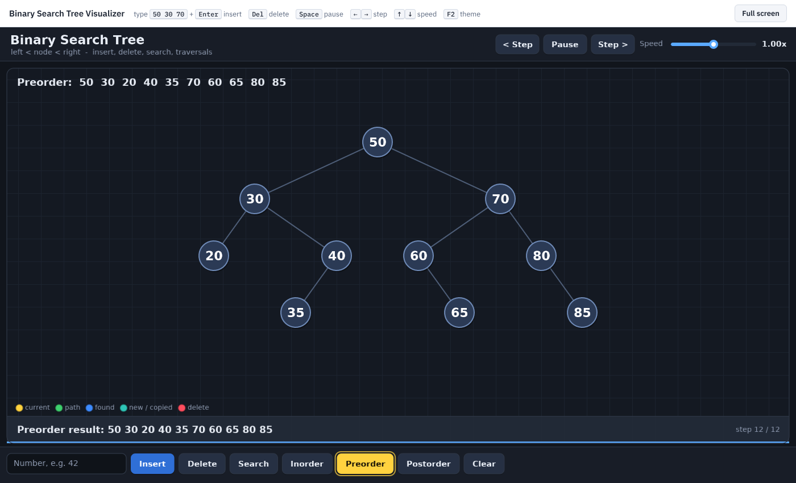

# Binary Search Tree Visualizer (C++17 + SDL2)

An interactive, animated visualizer for the **Binary Search Tree (BST)**, built for a DSA class
demo. Every operation is animated step by step, and the bar under the tree explains each step
in plain English ("35 > 30, go right").



* **Language / libraries:** C++17 and SDL2 only (no SDL_ttf, no other dependencies).
* **Font:** a bitmap font embedded in `src/FontData.cpp`; no font files are loaded.
* **Data structure from scratch:** plain `struct BSTNode { key, left, right }` with pointers.
  There is no `std::map`/`std::set`.

### Operations
| Operation | What the animation shows |
|-----------|--------------------------|
| **Insert** (one number or a list like `50 30 70 20`) | comparison at each node ("17 < 50, go left"), the new node growing into the empty spot |
| **Delete** | the search path, then the case: **leaf** (just removed), **one child** (child moves up), **two children** (find the inorder successor, copy it, delete the successor) |
| **Search** | the path of comparisons; found (blue) or "not in the tree" |
| **Inorder / Preorder / Postorder** | each node lights up in visiting order; the output builds up at the top |
| **Clear** | removes every node so you can start again |

---

## 1. Install SDL2

You need **SDL 2.0.18 or newer** (for `SDL_RenderGeometry`); any current package is fine.

### Windows (MSYS2 / MinGW-w64)
1. Install MSYS2 from <https://www.msys2.org> and open the **"MSYS2 UCRT64"** terminal.
2. Install the compiler, SDL2 and build tools:
   ```sh
   pacman -S --needed mingw-w64-ucrt-x86_64-gcc mingw-w64-ucrt-x86_64-SDL2 \
                      mingw-w64-ucrt-x86_64-cmake make
   ```
3. To run the `.exe` outside the MSYS2 terminal (for example by double-clicking it), copy
   `SDL2.dll` from `C:\msys64\ucrt64\bin\` into the folder that holds `TreeViz.exe`.

### Linux
```sh
sudo apt install build-essential libsdl2-dev cmake        # Debian / Ubuntu / Mint
sudo dnf install gcc-c++ make SDL2-devel cmake            # Fedora
sudo pacman -S base-devel sdl2 cmake                      # Arch / Manjaro
```

### macOS
```sh
xcode-select --install        # compiler + make
brew install sdl2 cmake       # Homebrew: https://brew.sh
```

---

## 2. Build and run

```sh
cd TreeViz
make            # builds ./TreeViz (TreeViz.exe on Windows)
./TreeViz       # or: make run
```

With CMake instead:
```sh
cmake -S . -B build-cmake -DCMAKE_BUILD_TYPE=Release
cmake --build build-cmake
./build-cmake/TreeViz
```
Both builds compile with `-Wall -Wextra` and produce zero warnings (GCC 13 and Clang).

### Run it on localhost (in a web browser, no compiler needed)
The `web/` folder already contains the program compiled to WebAssembly, so you only need a
local web server. (Opening `index.html` by double-clicking does **not** work: browsers block
the program file on `file://` pages.)
* **Windows:** double-click `web/start-server.bat` (needs Python from python.org with
  "Add Python to PATH" ticked).
* **Any OS, from a terminal:** `cd web` then `python serve.py` (or `python3 serve.py`).

The window prints the direct link, e.g. **http://localhost:8000**, and opens it in your browser.
If port 8000 is busy it uses 8001, 8002, … and prints that link instead. Keep the window open
while you use the page; Ctrl+C stops it. (`serve.py` is only a launcher, not part of the C++ project.)

**Deploy online with Vercel:** import this repository in Vercel and click Deploy. The included
`vercel.json` publishes the ready-made `web/` folder (no build step), so the site opens at your
`*.vercel.app` address.

To rebuild the web files after changing the C++ code: `make web` (needs the Emscripten SDK).
`#ifdef __EMSCRIPTEN__` in `App.cpp` hands each frame to the browser; the desktop build is unchanged.

### Test modes
| Command | What it does |
|---------|--------------|
| `./TreeViz --light` | start in the light theme (often better on projectors) |
| `./TreeViz --selftest` | 5000 random insert / delete / search operations, checking the BST ordering after each one |
| `./TreeViz --autotest` | drives the real program with simulated key presses and clicks, then prints the average FPS |
| `./TreeViz --shot out.bmp "Insert:50 30 70\|Search:30"` | runs button presses and saves a screenshot |

---

## 3. Controls

| Input | Action |
|-------|--------|
| Type a number (or a list `50 30 70`) | the input box focuses by itself as you type |
| **Enter** | insert the typed value(s); each insert animates in turn |
| **Delete** key | delete the typed value(s) |
| Buttons in the bottom bar | Insert, Delete, Search, Inorder, Preorder, Postorder, Clear |
| (after any operation) | the button you used last stays highlighted in yellow until you use another one |
| **Space** | pause / resume the animation |
| **Right arrow** | next step (pauses automatically, then steps one at a time) |
| **Left arrow** | previous step (replays it backwards) |
| **Up / Down arrows** | faster / slower (0.25x – 4x); there is also a speed slider in the top bar |
| **End** | skip to the end of the queued animation |
| **Tab** | focus / unfocus the input box |
| **F2** | light / dark theme |
| **F3** | FPS counter |
| **F11** | fullscreen |
| **Ctrl+Q** | quit |

**Colours:** yellow = node being compared · green = path already walked · blue = found ·
teal = new node / copied key · red = node being deleted.

---

## 4. How it works (architecture)

```
include/                         src/
  App.h            window, renderer, 60 FPS main loop
  TreeVisualizer.h BASE CLASS: layout, buttons, input box, keys
  BinaryVisBase.h  binary-tree helpers + the three traversal animations
  BSTVis.h         THE BINARY SEARCH TREE: insert, delete, search, traversals
  Anim.h           Frame (snapshot) + AnimPlayer (queue of steps) + easing
  Scene.h          draws and blends two frames, in-order layout, camera fit
  Gfx.h            anti-aliased shapes and text through SDL_RenderGeometry
  Font.h           embedded bitmap font (data in FontData.cpp)
  Theme.h          colours, highlight kinds, dark / light theme
  UI.h             Button, InputBox, Slider
```

**Base interface.** `BSTVis` derives from `TreeVisualizer`, which exposes `update(dt)`,
`draw(gfx, w, h)` and `handleEvent(event)`. The BST implements:
* `setup()`: buttons and info text,
* `onAction(id, input)`: runs an operation and calls `step("17 > 10, go right")` along the way,
* `buildScene(frame)`: describes the current tree as nodes and edges.

**Animation as a queue of steps.** The real algorithm runs immediately on the real tree.
Each `step()` stores a snapshot (**Frame**) of every node's id, position, label and colour, plus
the log message. `AnimPlayer` plays the frames in order and eases between consecutive frames
(ease-in-out cubic):
* nodes are matched by id, so a moved node **glides**, a new node **grows in** and a deleted node
  **fades out**; a changed key (successor copy) cross-fades,
* edges are drawn between the *current* animated positions, so they follow the nodes,
* the camera (zoom and centre) is interpolated, so the tree always fits the window.

Because the steps are stored, pause, single-step, step-back and speed control are simple and
reliable. Operations clicked during an animation are queued behind it.

**Layout.** A node's x position is its index in an inorder traversal and y is its depth. A left
child is therefore always left of its parent, and reading the nodes from left to right gives the
keys in sorted order.

**Rendering.** VSync, double-buffered, 60 FPS. Circles and lines are drawn as triangles with a
1-pixel transparent edge, which gives anti-aliasing. HiDPI screens render at full resolution, and
the window is resizable (minimum 1000 x 650).

---

## 5. Font licence
The embedded glyph bitmaps were rasterised from **DejaVu Sans** (Bitstream Vera licence, which
allows embedding and redistribution). Fonts © Bitstream, Inc. and the DejaVu authors.

See also **DEMO_GUIDE.md** (what to present and say) and **VIVA_QA.md** (25 viva questions with answers).
